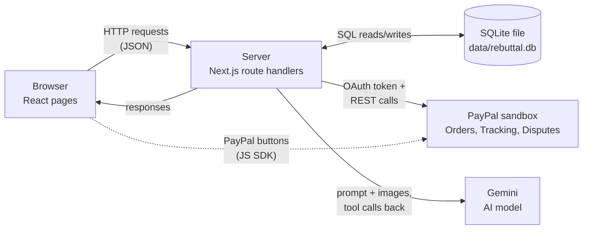

# Learn how Rebuttal works

A walkthrough for someone new to programming. It covers what Rebuttal does, how it was built, what happens when you click a button, the ideas behind it, and what is still unfinished.

---

## 1. The big picture

**What it does.** When a buyer opens a PayPal dispute, PayPal freezes the seller's money and starts a deadline. Rebuttal helps the seller respond. It collects the facts, reads the seller's proof (a carrier screenshot, photos), and recommends one of three actions:

- **fight**: send evidence to PayPal;
- **offer**: propose a partial refund;
- **accept**: refund in full.

The seller approves, and Rebuttal sends the response to PayPal.

**Who it's for.** Small online shops that take PayPal and have no time or staff to fight disputes.

**The pieces.**

- **Browser.** The page you look at. It shows disputes and buttons. It holds no secrets.
- **Server.** A program (Next.js running on Node.js) that does the real work. It holds the passwords (API keys) and talks to the outside world.
- **Database.** One file (SQLite) where the server keeps disputes, orders, evidence and a log of every PayPal call.
- **PayPal.** The payment company's API (a service other programs can call), in its "sandbox" (test) version.
- **Gemini.** Google's AI model. It reads images and recommends an action.



The browser only talks to our server, with one exception: the PayPal checkout buttons load straight from paypal.com. Every secret stays on the server.

---

## 2. The process, step by step

These steps are in the order the work actually happened.

**Step 1: Look before touching anything.** I checked:

- that the repo was empty;
- which environment variables (settings passed to a program from outside) were set;
- that PayPal's sandbox and Gemini could be reached from this machine (a quick `curl` to each).

*Risk:* building against a service that's blocked by the network. *Guard:* test reachability first. If a host had been blocked, that service would have used its mock.

**Step 2: Read the official docs.** I read PayPal's "Test and go live" disputes page, the buyer set-up page and the Disputes OpenAPI schema (a machine-readable description of every endpoint). For Gemini, I listed the available models from the API itself.

*Risk:* calling endpoints from memory that have changed. *Guard:* every request shape came from the schema. I also sent one deliberate bad request (a fake transaction ID). PayPal replied `TRANSACTION_NOT_ELIGIBLE`, which proved our login and permissions worked.

**Step 3: Read the installed type definitions.** The libraries had changed since my training. For example, AI SDK 7 renamed things, Next.js 16 has new defaults, and TypeScript "latest" is now version 7. So I read the `.d.ts` files (files that describe a library's functions and their inputs) before writing calls.

*Guard:* the TypeScript compiler (`npm run typecheck`) catches any mismatch.

**Step 4: The lifecycle script first.** The brief asked for `scripts/sandbox-lifecycle.ts` before any UI. It takes a dispute from "opened" to "resolved" in the sandbox. Without a real buyer transaction, it replays recorded responses ("fixtures") and prints each step as LIVE or SIMULATED.

*Risk:* a step the sandbox refuses would stop the whole run. *Guard:* that step falls back to its fixture, gets labelled, and the run continues.

**Step 5: The core, without a UI.** I built the database, the demo scenario, the rules table, the dispute state machine, the PayPal adapter and a sandbox simulator.

**Step 6: The AI agent, tested live from a script.** I ran the agent against Gemini from the command line and read its output. That surfaced real problems:

- a "1 day" that should have been 2 (a time-zone bug);
- a 100% confidence score;
- a schema length limit that crashed a run;
- an "accept" recommendation for the bowl dispute that lacked PayPal knowledge.

Each was fixed and logged in DECISIONS.md.

**Step 7: A thin end-to-end slice.** This was the UI plus one click-through of the whole story in mock mode, driven by a headless browser (a browser with no window, controlled by code) that took screenshots. It was committed only once all 9 story beats worked.

**Step 8: Deepen.** I added:

- the shop page with the PayPal buttons;
- tests;
- evidence upload (images and PDFs);
- handling for Gemini's free-tier limit of about 20 requests per day per model;
- the written deliverables;
- a check in a fresh copy of the repo with every key removed;
- the pull request, then layout fixes for phones.

---

## 3. What happens when the seller clicks "Build my case"

**Terms you'll meet:**

- A **request** is a message from the browser to the server ("please start the analysis").
- A **response** is the server's reply.
- An **API route** is a server address that handles one kind of request.
- A **database row** is one record in a table, like one line in a spreadsheet.
- A **background job** is work the server keeps doing after it has already replied.

1. **The click.** The button at `src/components/DisputeDetail.tsx:98` calls `run(...)` (line 30). `run` marks the page busy, then calls `api(...)`.
2. **The request.** `api()` at `src/components/format.ts:33` sends `POST /api/disputes/PP-D-21837/analyse`. `POST` means "do something", as opposed to `GET`, which means "give me something".
3. **The API route.** Next.js maps that address to the file `src/app/api/disputes/[id]/analyse/route.ts`. Its `POST` function (line 4) calls `handle()` (`src/lib/http.ts:11`). `handle()` turns any error into a tidy JSON reply.
4. **Start the background job.** `startAnalysis()` at `src/lib/service.ts:119` checks the dispute can be analysed. It starts `analyse()` without waiting (`void analyse(...)`, line 123). The server replies `{"started": true}` right away, so the page doesn't freeze.
5. **Load the case.** `analyse()` (`src/lib/ai/agent.ts:377`) calls `loadCase()` (`src/lib/casefile.ts:71`). That reads the dispute row, the order row and the evidence rows from SQLite through `db()` (`src/lib/db.ts:88`).
6. **Change state.** `setStage(..., ANALYZE)` (`agent.ts:382`) runs the state machine `transition()` (`src/lib/workflow.ts:25`). The dispute moves from `new` to `analyzing`. An `analyses` row is created (line 385) to hold the progress.
7. **Collect the facts that need no AI.** `baseFacts()` (`casefile.ts:107`) reads the shipping address, the PayPal tracker (`trackerOf`, line 98), whether a listing exists, and so on.
8. **Choose a mode** (`agent.ts:393–395`):
   - **cached**: the same inputs were analysed before;
   - **live**: call Gemini;
   - **recorded**: replay a saved real run;
   - **rules**: no AI at all.
9. **The agent loop (live).** `runLive()` (line 223) calls `generateText()` (line 276) with a list of tools. Gemini answers by asking for tools, step by step. Each tool runs our code:
   - **`get_dispute`** (`toolGetDispute`, line 111) calls `readDispute()` (`src/lib/paypal/gateway.ts:104`). That fetches the dispute from PayPal, or replays it, and `recordCall()` (`src/lib/calls.ts:13`) logs the call.
   - **`get_transaction`** (line 128) fetches the PayPal order.
   - **`read_carrier_document`** (line 243) calls `readCarrierDocument()` (`src/lib/ai/vision.ts:20`). That sends the screenshot to Gemini and forces a structured answer (`toolChoice`, line 29). Then `carrierFacts()` (line 174) checks the address match (`addressMatches`, `src/lib/rules.ts:73`) and counts the days before the claim (`daysBetween`, `rules.ts:86`).
   - **`check_evidence_coverage`** (line 268) runs `coverage()` (`rules.ts:255`) against the rules table (`rules.ts:236`).
   - **`submit_recommendation`** (line 273) ends the loop (`stopWhen`, line 281).

   Every tool call is written to the trace through the `Tracer` (line 89), so the page can show progress.
10. **Rate limits and fallbacks.** Each Gemini request goes through `chainModel()` (`src/lib/ai/model.ts:64`):
    - `acquireSlot()` (line 35) waits for a free slot;
    - on "busy" or "quota used up", it tries the next model (line 84).
11. **Finish.**
    - `finalise()` (`agent.ts:353`) converts any offer percentage into whole cents with `percentOf()` (`src/lib/money.ts:65`).
    - The result is saved with `status: "done"` (line 443).
    - The stage moves to `ready` (line 451).
    - A timeline event is logged (line 453).
    - A live run is also cached (line 412).
12. **The screen updates by polling.** Meanwhile the page asks the server every 0.6 s (`src/components/App.tsx:80`). It calls `GET /api/disputes/PP-D-21837` (`src/app/api/disputes/[id]/route.ts:4`), which `disputeView()` (`src/lib/views.ts:144`) builds. `Trace` (`DisputeDetail.tsx:194`) shows each tool as it finishes. `Verdict` (line 257) and `Checklist` (line 310) appear when the result is ready.

---

## 4. The theory, simply

**Client vs server.** The client is your browser. The server is a computer elsewhere that answers it. Anything sent to the browser can be read by whoever is using it, so API keys stay on the server and the browser asks the server to act for it. *Analogy:* a restaurant customer orders from a waiter; only the kitchen holds the knives.

**APIs, REST, HTTP, JSON.**
- An **API** is a menu of things a program can ask another program to do.
- **REST** is a common style of API: things are addresses (`/v1/customer/disputes/PP-D-21837`) and you act on them with HTTP methods: `GET` reads, `POST` creates or acts, `PATCH` edits.
- **Status codes** say how it went: 200 OK, 201 Created, 400 bad request, 401 not logged in, 404 not found, 429 too many requests, 503 busy.
- **JSON** is the text format both sides use, for example `{"status": "RESOLVED"}`.

*Analogy:* posting forms to a government office. Each form type has a fixed layout and you get back a stamped reply.

**OAuth access tokens; sandbox vs live.** The server swaps its client ID and secret for a short-lived **access token** (`getAccessToken`, `src/lib/paypal/http.ts:47`) and attaches it to every call. The **sandbox** is PayPal's practice copy with fake money; **live** is real money. Rebuttal only uses the sandbox. To act *as the buyer*, it adds a `PayPal-Auth-Assertion` header (`buyerAuthAssertion`, line 69). *Analogy:* a day pass at a building's front desk; the sandbox is the fire-drill version of the building.

**Webhooks vs polling.**
- **Polling** means asking again and again: "anything new?"
- A **webhook** means the other side calls you when something changes.

Rebuttal polls, both from the browser to our server and when re-reading PayPal, because it's simple and works anywhere. Webhooks are on the "what's next" list. *Analogy:* refreshing a tracking page versus getting a text when the parcel arrives.

**Databases and why SQLite.** A database stores data in tables of rows so it survives restarts and can be searched. SQLite is a whole database in one file, with no separate server to run. That's ideal for a demo you can start with one command. *Analogy:* a well-organised filing cabinet, versus a filing department you'd have to staff.

**State machines.** A state machine is a list of allowed states and the moves between them. A dispute here goes `new → analyzing → ready → submitted → won`, and illegal moves are refused (`transition`, `workflow.ts:25`). PayPal's own statuses are a second state machine (`src/lib/paypal/sim.ts`). It stops nonsense like "approve" before "analyse". *Analogy:* a board game; you can only move to squares the rules allow.

**Money as whole cents.** Computers store decimals in binary, so `0.1 + 0.2` gives `0.30000000000000004`. Money must never drift, so Rebuttal stores `8400` (cents) and converts to `"84.00"` only when talking to PayPal (`parseMinor`, `money.ts:15`). A 40% offer is computed in basis points (hundredths of a percent) with integer maths:

```ts
export function percentOf(minor: number, basisPoints: number): number {
  const num = minor * basisPoints;
  const q = Math.floor(num / 10000);
  const r = num - q * 10000;
  return r * 2 >= 10000 ? q + 1 : q; // round half up
}
```

**LLM tool-calling agents, schemas, validation.**
- An **LLM** (large language model) produces text.
- In **tool calling**, we give it a list of functions it may request, such as "read this document". It replies with a request, our code runs it and returns the result, and it continues. That loop is an **agent**.
- A **schema** describes exactly what shape an answer must have. We write ours with **zod**, a library for describing and checking data. Example: `action` must be `fight`, `offer` or `accept`, and `confidence` must be a number from 0 to 100.
- We **validate** every answer against the schema, because models sometimes return wrong shapes or invent things. Code also does the facts (address match, dates, money) rather than trusting the model.

*Analogy:* a smart intern who fills in a form you designed, and you check the form before filing it.

**Rate limits, caching, fallbacks.**
- A **rate limit** caps how often you may call a service. Gemini's free tier allows about 20 requests per model per day.
- A **cache** remembers answers so you don't ask twice.
- A **fallback** is plan B when plan A fails.

Rebuttal limits itself to 10 requests a minute and caches vision reads and whole analyses. When it can't call Gemini, it falls back down a chain: another model, then a recorded real run, then the rules alone, labelling each one. *Analogy:* a library's daily borrowing limit, keeping your own photocopies, and borrowing from a friend when the library is closed.

**Mocks, adapters, fixtures.**
- An **adapter** is one doorway with two possible rooms behind it: the real service or a stand-in (`runAction`, `gateway.ts:61`).
- A **mock** is the stand-in.
- **Fixtures** are saved example responses, shaped exactly like the real ones.

That's why the app works with no keys: every outside service has a mock, and the screen says SIMULATED. *Analogy:* a flight simulator; same controls, no real plane.

**Tests.** Tests are small programs that check the code behaves as expected (`npm test` runs 35). They prove that:

- the money maths is right;
- illegal state moves are refused;
- the rules table gives fight, offer or accept for the right facts;
- the AI schemas reject bad output;
- the whole demo story completes.

They do **not** prove that PayPal's live sandbox behaves like our simulator, or that Gemini will always answer well. *Analogy:* a car's crash-test results don't prove how it handles on your road.

**Git branches, commits, pull requests.**
- A **commit** is a saved snapshot with a message.
- A **branch** is a separate line of snapshots, so work doesn't disturb `main`.
- A **pull request** (PR) asks to merge a branch into `main` and shows every change for review.

This work is on `claude/gallant-ritchie-nxxyov`, and the PR is https://github.com/eshygn/rebuttal/pull/1. *Analogy:* drafts of an essay, a separate copy for edits, and handing the edited copy to your editor.

**Deployment and `render.yaml`.** Deployment means running the app on a public server. Render reads `render.yaml` and then:

1. creates one free web service;
2. runs `npm ci && npm run build` to install and compile;
3. runs `npm start`;
4. checks `/api/state` to see the app is alive;
5. takes your keys from its settings page, never from the repo.

Free instances sleep when idle, so the first visit takes about a minute. *Analogy:* a recipe card you hand to a kitchen that cooks it for you.

---

## 5. Five key decisions

1. **One adapter with live and simulated versions, labelled on screen.** *Not taken:* live-only (breaks without keys) or a fake-only demo (not honest). Judges can run it anywhere and still see what is real.
2. **AI reads, code decides facts and money.** *Not taken:* letting the model compute dates, match addresses or pick dollar amounts. Models make arithmetic and date mistakes; code doesn't.
3. **A fixed rules table beside the agent.** *Not taken:* AI-only judgment. The rules give a baseline that can be checked and explained, and the UI shows whether the agent agrees.
4. **SQLite and polling.** *Not taken:* a hosted database and websockets (a connection the server can push updates through). One command to run, no extra services, and it works on Render's free plan.
5. **Build against the docs and record real responses.** *Not taken:* waiting for a live sandbox transaction before building. The sandbox only lets a real buyer dispute their own payment, so waiting would have blocked everything.

More choices are in [DECISIONS.md](DECISIONS.md).

---

## 6. What's honest about it

**Really talks to PayPal (verified on 4 Nov 2026):**
- OAuth login, listing disputes, and the create-dispute endpoint (reached; it rejected a transaction that wasn't the buyer's);
- creating Orders v2 orders with the Server SDK, and a test-card capture;
- the PayPal JS SDK buttons rendering on `/shop`.

**Not yet run live:**
- a dispute's full lifecycle (evidence, offer, adjudication, buyer accepting). The one transaction tried (4 Nov) was refused, because it went from the shop to the buyer and was still pending. See DECISIONS.md.
- a completed checkout through the buttons, which needs the sandbox buyer's login;
- live order tracking (the Server SDK call is written but hasn't run against a real captured order).

All of these currently run through the simulator.

**Really talks to Gemini:**
- the agent ran live on all three disputes;
- it read the carrier screenshot and an uploaded PDF;
- it compared the bowl photos.

The recordings it replays are those real runs.

**How the app shows the difference:**
- the top-bar chips (PayPal: sandbox live / mock; AI: Gemini live / recorded runs);
- a LIVE or SIMULATED badge on every PayPal toast and log row, with the reason when the sandbox refused;
- dispute cards marked "Sandbox" or "Simulated";
- the agent panel saying "Gemini live", "cached run", "Recorded Gemini run" or "Rules only".

In mock mode, everything PayPal-related on screen is simulated. Nothing pretends otherwise.

---

## 7. Anything remaining

- [ ] **Run the sandbox lifecycle live.**
  - *Why not done:* the transaction you sent (`3KV701938H745371C`) was refused, and the script found three reasons (details in DECISIONS.md):
    - it's £40 paid *to* the personal account, not *to* our business account;
    - it's still pending;
    - `PAYPAL_SANDBOX_BUYER_EMAIL` is set to the business account.
  - *You:*
    1. set `PAYPAL_SANDBOX_BUYER_EMAIL` to the personal account (`sb-3j7y…@personal.example.com`) in the environment settings;
    2. log in at sandbox.paypal.com **as that personal account** and send $84.00 USD **to** `sb-otkh…@business.example.com` (the account that owns the REST app);
    3. copy the transaction ID from the personal account's activity page.
  - *Then:* `npx tsx scripts/sandbox-lifecycle.ts <TRANSACTION_ID>`, then commit `fixtures/paypal/lifecycle/` and update DECISIONS.md.
- [ ] **Bind the demo story to real sandbox disputes** (optional, so the video shows LIVE badges).
  - *You:* make two buyer payments ($84.00 and $65.00 USD).
  - *Then:* put the IDs in `.env` as `SANDBOX_INR_TRANSACTION_ID=` and `SANDBOX_SNAD_TRANSACTION_ID=`, then `npm run dev`.
- [ ] **Confirm the outcome code after a buyer accepts an offer.**
  - *Why:* it's assumed to be `RESOLVED_WITH_PAYOUT`; the docs don't say.
  - *Needs:* the SNAD live run above. Check the API log for `dispute_outcome`.
- [ ] **Test live order tracking.**
  - *Why:* the tracking call is written but has never run against a real captured order.
  - *Needs:* one completed sandbox checkout on `/shop`, then click "Mark shipped + add tracking" and confirm the API log row says LIVE.
- [ ] **Deploy to Render.**
  - *You:* in Render, choose New → Blueprint, pick this repo and branch (or `main` after merging), and add the keys as environment variables (or leave them empty for mock mode).
  - *Then:* copy the URL into the README's "Hosted demo" line, then `git commit -am "Add hosted URL" && git push`.
- [ ] **Merge the PR** after review: https://github.com/eshygn/rebuttal/pull/1
- [ ] **Record the video** (under 2:50) using [DEMO.md](DEMO.md).
  - *Before recording:* run the story once and click Reset, so the Gemini result is cached.
  - *Note:* the free tier resets daily, so record on a fresh day if you want "Gemini live".
- [ ] **Re-record the AI fallbacks** (optional; the INR recording predates the final prompt). This uses about 15 Gemini requests: `npx tsx scripts/record-ai.ts`
- [ ] **Submit on Devpost** before 12 Nov 2026, 12:00 PST. Paste the fields from [SUBMISSION.md](SUBMISSION.md), add the video link, the repo link and the hosted URL.

---

## 8. How to keep learning

1. **Break the offer rule.** In `src/lib/ai/agent.ts`, `finalise()` clamps the offer to below the full amount. Remove the `clampMinor(...)` wrapper and run `npm test`. *Hint:* nothing fails. That shows a gap in the tests. Write a test that would catch it.
2. **Change a rule's weight.** In `src/lib/rules.ts`, make `variationDisclosed` `"supporting"` instead of `"strong"`, then run `npm test`. *Hint:* watch the "says offer for a not-as-described case" test in `tests/rules.test.ts`, and work out the new score by hand.
3. **Add a dispute reason.** Add rules for `CREDIT_NOT_PROCESSED` (proof of refund) in `RULES`. *Hint:* copy the shape of `buyerComms` and use evidence type `PROOF_OF_REFUND`.
4. **Follow one PayPal call.** Start the app, click Next once, open "API log" and expand the row. Then find where that row was written. *Hint:* search the code for `recordCall(`.
5. **Add a state.** Add an `"appealed"` stage to `src/lib/workflow.ts`. *Hint:* TypeScript will point to every place that must change. Run `npm run typecheck`.

**Official docs to read next:**
- Next.js App Router: https://nextjs.org/docs/app (and `node_modules/next/dist/docs/` in this repo)
- PayPal Disputes: https://developer.paypal.com/disputes/overview and the API reference https://developer.paypal.com/api/customer-disputes/v1
- PayPal Orders v2 and JS SDK: https://developer.paypal.com/docs/checkout/
- AI SDK (tool calling): https://ai-sdk.dev/docs
- Gemini API: https://ai.google.dev/gemini-api/docs
- zod: https://zod.dev · SQLite: https://sqlite.org/quickstart.html · Vitest: https://vitest.dev · Render Blueprints: https://render.com/docs/blueprint-spec

---

## 30-second recap

Rebuttal helps small PayPal sellers answer disputes instead of giving up. When a dispute arrives, a Gemini agent pulls the dispute, the payment and the tracking record from PayPal. It reads the seller's carrier screenshot, which PayPal's own tracking never sees, and checks a fixed rules table of what each dispute reason needs. Then it recommends fight, offer a partial refund, or accept. Code, not the AI, handles dates, address checks and money, which is stored in whole cents. The seller approves and Rebuttal submits through the PayPal Disputes API. Every PayPal call is shown on screen as live or simulated, so it runs with no keys and stays honest about what's real.
